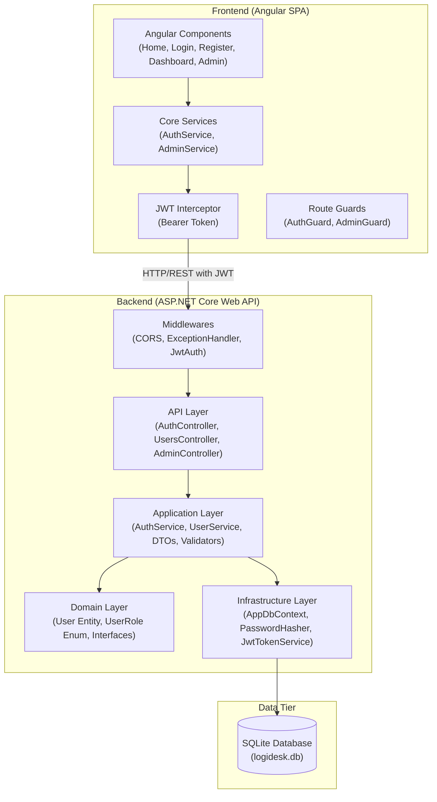

# LogiDesk – System Architecture & Technology Standards

## 1. Executive Summary

LogiDesk is a logistics operations helpdesk platform built using **ASP.NET Core (.NET)** for the backend RESTful API services and **Angular** for the Single-Page Application (SPA) frontend.

---

## 2. Technology Stack Selection

Following the project backlog stack decision:
- **Backend**: ASP.NET Core Web API (.NET 10 / .NET 11)
  - **ORM**: Entity Framework Core
  - **Database**: SQLite (local development and automated test isolation) / SQL Server ready
  - **Security**: JWT (JSON Web Tokens) with ASP.NET Core Authentication/Authorization, cryptographically secure password hashing (PBKDF2 / ASP.NET Identity PasswordHasher)
  - **API Documentation**: OpenAPI / Swagger UI
  - **Testing**: xUnit with InMemory/SQLite test fixtures
- **Frontend**: Angular (v19/v20/v21)
  - **Architecture**: Modern Standalone Components, Signal-based reactivity, TypeScript
  - **Routing**: Angular Router with functional Route Guards (`authGuard`, `adminGuard`)
  - **HTTP**: HttpClient with `HttpInterceptorFn` for Bearer token injection and 401 handling
  - **Design**: Clean modern UI, responsive layout, accessible form validation

---

## 3. High-Level Architecture Diagram

---

## 4. Role-Based Access Control (RBAC)

The system supports four distinct roles:

| Role | Responsibilities | Default Permissions |
|---|---|---|
| **Customer** | End-users receiving or sending shipments | Register, login, create tickets, view own tickets and comments |
| **Support Agent** | Front-line support personnel | View assigned tickets, update ticket statuses, add notes/comments |
| **Operations Manager** | Supervisors managing logistics queue | Assign tickets, view all ticket queues, operational dashboards |
| **Administrator** | System operators | Manage user roles, activate/deactivate accounts, system configuration |

---

## 5. Security Architecture

1. **Authentication**:
   - Passwords hashed using ASP.NET Core's HMAC-SHA512 `PasswordHasher<User>` with unique per-user salts.
   - Upon successful credentials verification, server signs a JWT with:
     - `ClaimTypes.NameIdentifier` (`sub` / UserId)
     - `ClaimTypes.Email`
     - `ClaimTypes.Name`
     - `ClaimTypes.Role`
     - Configurable expiry (e.g. 8 hours)
2. **Authorization**:
   - Declarative `[Authorize(Roles = "Administrator")]` on administrative controllers and endpoints.
   - Granular claims extraction in application services.
3. **Frontend Protection**:
   - `authGuard` verifies user token state before allowing access to protected dashboard.
   - `adminGuard` verifies `role === 'Administrator'` before allowing navigation to administrative views.
   - HTTP Interceptor handles `401 Unauthorized` responses by automatically redirecting to login.
