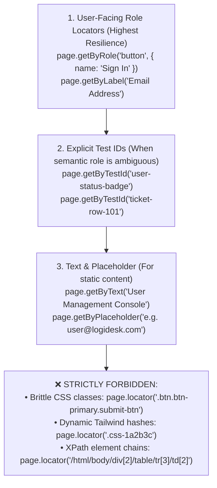

# LogiDesk – Test Automation Framework Design

**System Under Test**: LogiDesk Web Application (.NET Web API + Angular SPA)  
**Selected Framework**: **Playwright (TypeScript)** + **xUnit (.NET Integration Tests)**  
**Execution Context**: Solo Engineer / Single Developer & QA (Atibali)  
**Version**: 1.1  
**Date**: November 2026  
**Audience**: Solo Developer, Reviewer  

---

## 1. Architectural Overview & Solo Tooling Choice

For a solo engineer, maintaining a complex, brittle automation framework is unsustainable. We adopt a **high-efficiency, low-maintenance two-tier automation architecture**:
1. **Tier 1 (Fast In-Process API & Integration Tests)**: .NET `xUnit` + EF Core for sub-second business logic, RBAC matrix, and status transition validation.
2. **Tier 2 (Targeted End-to-End UI & Multi-Role Journeys)**: **Playwright (TypeScript)** for automated browser tests that validate full cross-role flows without flakiness.

### Why Playwright for a Solo Engineer?
* **Zero Flakiness Auto-Waiting**: Eliminates manual wait/sleep timers by automatically waiting for Angular signals, DOM elements, and API calls to resolve.
* **Multi-Role Contexts in One Test**: A single test script can open multiple isolated browser tabs/contexts simultaneously (e.g., Customer tab creates ticket, Manager tab assigns it, Agent tab resolves it).
* **Instant Failure Diagnostics**: Out-of-the-box HTML reports, trace viewer, and failure screenshots pinpoint regressions immediately without manual reproduction.
* **Low Maintenance**: Fast execution with minimal boilerplate.

---

## 2. Framework Directory Structure

The automated test framework is housed under `tests/automation/`:

```text
LogiDesk/
├── tests/
│   └── automation/
│       ├── .github/
│       │   └── workflows/
│       │       └── e2e-tests.yml        # Solo CI Pipeline definition
│       ├── config/
│       │   ├── playwright.config.ts     # Global Playwright configuration
│       │   └── environments.ts          # Base URLs & credentials
│       ├── fixtures/
│       │   ├── base.fixture.ts          # Custom test fixture with auto-authenticated pages
│       │   └── auth.fixtures.ts         # Pre-authenticated states (Customer, Agent, Manager, Admin)
│       ├── pages/                       # Page Object Model (POM) classes
│       │   ├── base.page.ts             # Shared page actions (nav, alerts, toasts)
│       │   ├── login.page.ts            # Login page interactions & assertions
│       │   ├── register.page.ts         # Customer registration page
│       │   ├── dashboard.page.ts        # Role-adaptive dashboard page
│       │   ├── admin-users.page.ts      # User management console (LD-08)
│       │   ├── ticket-create.page.ts    # Ticket submission form (LD-03)
│       │   └── ticket-detail.page.ts    # Comments, status updates & history
│       ├── specs/                       # Test specifications organized by domain/epic
│       │   ├── auth/
│       │   │   ├── login.spec.ts        # LD-02 login & session tests
│       │   │   └── register.spec.ts     # LD-01 customer registration tests
│       │   ├── admin/
│       │   │   └── user-management.spec.ts # LD-08 admin user controls
│       │   ├── tickets/
│       │   │   ├── ticket-lifecycle.spec.ts # Multi-role workflow (LD-03, 05, 06)
│       │   │   └── data-isolation.spec.ts   # Security / IDOR tests (LD-04)
│       │   └── api/
│       │       └── rbac-matrix.spec.ts  # Pure API authorization tests
│       ├── utils/
│       │   ├── test-data-generator.ts   # Dynamic data helpers
│       │   └── db-helpers.ts            # SQLite test reset & seeding utilities
│       ├── package.json                 # Automation npm dependencies
│       └── tsconfig.json                # TypeScript compiler configuration
```

---

## 3. Naming Conventions

### 3.1 Files and Directories
* **Spec Files**: `<feature-name>.spec.ts` (e.g., `login.spec.ts`, `user-management.spec.ts`).
* **Page Object Classes**: `<feature-name>.page.ts` (e.g., `login.page.ts`).
* **Class Names**: PascalCase ending in `Page` (e.g., `LoginPage`, `AdminUsersPage`).

### 3.2 Test Suites and Test Cases
Tests follow the **[Story-ID] Scenario - Expected Outcome** convention:

```typescript
// Example: login.spec.ts
import { test, expect } from '../../fixtures/base.fixture';

test.describe('Authentication & Access Control', () => {
  test.describe('LD-02: User Login', () => {
    test('@smoke @auth [LD-02] Should authenticate with valid credentials and redirect to dashboard', async ({ loginPage, dashboardPage }) => {
      await loginPage.navigate();
      await loginPage.login('admin@logidesk.com', 'Admin@123');
      await expect(dashboardPage.welcomeHeader).toContainText('System Administrator');
      await expect(dashboardPage.roleBadge).toHaveText('Administrator');
    });

    test('@regression @auth [LD-02] Should reject invalid credentials with safe error message', async ({ loginPage }) => {
      await loginPage.navigate();
      await loginPage.login('admin@logidesk.com', 'IncorrectPassword!');
      await expect(loginPage.errorMessage).toHaveText('Invalid email or password.');
    });
  });
});
```

---

## 4. Locator Rules & Priority Strategy

To eliminate test maintenance overhead, use this strict **locator hierarchy**:



### Locator Best Practices:
1. **Always use Web-First Assertions**:
   ```typescript
   // Recommended (Playwright automatically retries until condition is met or timeout)
   await expect(page.getByRole('button', { name: 'Save' })).toBeVisible();

   // Anti-Pattern (DO NOT DO THIS)
   const isVisible = await page.locator('#save').isVisible();
   expect(isVisible).toBe(true);
   ```
2. **Encapsulate Locators in Page Objects**: Tests must never define raw selectors; all locators must be defined as getters or `readonly Locator` fields in the appropriate Page class.

---

## 5. Tagging Taxonomy & Filtering Strategy

Tags enable the solo developer to selectively execute subsets of tests to get fast feedback:

| Tag | Category | Purpose | Typical Execution Trigger |
|---|---|---|---|
| `@smoke` | Sanity Suite | Critical path tests (< 3 minutes total runtime) | Pre-commit / local PR check |
| `@regression` | Full Suite | Exhaustive functional & edge-case tests | Nightly run or pre-release verification |
| `@critical` | Severity | High-impact security and workflow flows | PR validation gates |
| `@auth` | Domain | Login, registration, token refresh, password tests | When auth/identity components change |
| `@rbac` | Security | Role permissions & data isolation tests | Security regressions & PR checks |
| `@customer` | Role Track | Flows specific to Customer Portal | Customer feature changes |
| `@agent` | Role Track | Flows specific to Support Agent Workspace | Agent queue & triage changes |
| `@manager` | Role Track | Flows specific to Operations Dispatcher | Manager assignment changes |
| `@admin` | Role Track | Flows specific to System Administrator | Admin console changes |
| `@api` | Pure API | Headless API requests bypassing browser | Ultra-fast backend tests |

---

## 6. How to Run Locally (Solo Developer)

### 6.1 Setup & Installation
```bash
# Navigate to the automation directory
cd tests/automation

# Install dependencies and Playwright browser binaries
npm install
npx playwright install --with-deps chromium firefox
```

### 6.2 Running Test Suites

```bash
# 1. Run all tests in headless mode
npx playwright test

# 2. Run the Smoke Suite only (Fastest feedback)
npx playwright test --grep "@smoke"

# 3. Run a specific role track (e.g. Admin tests)
npx playwright test --grep "@admin"

# 4. Run tests against a specific browser
npx playwright test --project=chromium

# 5. Run tests in interactive UI Mode (Time-travel debugger)
npx playwright test --ui

# 6. Run tests with browser visible (Headed mode)
npx playwright test --headed

# 7. Debug a failing test step-by-step
npx playwright test specs/auth/login.spec.ts --debug
```

### 6.3 Viewing Test Reports & Traces
```bash
# View the HTML report of the latest run
npx playwright show-report

# Open a recorded trace file from a failed run
npx playwright show-trace test-results/failed-test/trace.zip
```

---

## 7. How to Run in CI/CD (GitHub Actions Pipeline)

Below is the automated GitHub Actions workflow (`.github/workflows/e2e-automation.yml`) designed to automatically boot the .NET Web API and Angular SPA before executing the Playwright test suite:

```yaml
name: LogiDesk E2E & QA Automation Suite

on:
  push:
    branches: [ main ]
  pull_request:
    branches: [ main ]

jobs:
  test:
    name: Run Automated Tests
    runs-on: ubuntu-latest
    timeout-minutes: 15

    steps:
      - name: Checkout Repository
        uses: actions/checkout@v4

      # 1. Setup .NET Runtime & Build Backend
      - name: Setup .NET SDK
        uses: actions/setup-dotnet@v4
        with:
          dotnet-version: '11.0.x'

      - name: Restore & Build .NET Solution
        run: |
          cd src/backend
          dotnet restore
          dotnet build --configuration Release --no-restore
          dotnet test --no-build --verbosity normal

      - name: Start .NET Web API in Background
        run: |
          cd src/backend/LogiDesk.Api
          dotnet run --no-build --configuration Release --urls "http://127.0.0.1:5000" &
        env:
          ASPNETCORE_ENVIRONMENT: "Development"

      # 2. Setup Node.js & Build Frontend
      - name: Setup Node.js
        uses: actions/setup-node@v4
        with:
          node-version: '24'
          cache: 'npm'
          cache-dependency-path: 'src/frontend/package-lock.json'

      - name: Install Frontend Dependencies & Start Angular
        run: |
          cd src/frontend
          npm ci
          npm run build
          npx serve -s dist/logidesk-ui -l 4200 &

      # 3. Setup Playwright & Execute Tests
      - name: Setup Automation Suite
        run: |
          cd tests/automation
          npm ci
          npx playwright install --with-deps

      - name: Wait for Services to be Healthy
        run: |
          npx wait-on http://127.0.0.1:5000/openapi/v1.json http://127.0.0.1:4200 --timeout 60000

      - name: Execute Playwright Smoke Tests
        run: |
          cd tests/automation
          npx playwright test --grep "@smoke"
        env:
          BASE_URL: "http://127.0.0.1:4200"
          API_URL: "http://127.0.0.1:5000"
          CI: true

      # 4. Publish Test Artifacts & Failure Reports
      - name: Upload Playwright HTML Report
        uses: actions/upload-artifact@v4
        if: always()
        with:
          name: playwright-report
          path: tests/automation/playwright-report/
          retention-days: 14

      - name: Upload Traces on Failure
        uses: actions/upload-artifact@v4
        if: failure()
        with:
          name: failure-traces
          path: tests/automation/test-results/
          retention-days: 7
```

---

## 8. Flakiness Prevention for Solo Development

To ensure the solo engineer does not waste time chasing false alarms:
1. **Zero Explicit Sleeps**: Never use `page.waitForTimeout()` or `Thread.Sleep()`. Rely exclusively on Playwright's auto-waiting web assertions (`expect(locator).toBeVisible()`).
2. **Deterministic Data Cleanliness**: Automated tests use unique timestamped entities or run against clean test DB state.
3. **Automatic Retries in CI**:
   * Locally: `retries: 0` (immediate fail-fast feedback).
   * In CI: `retries: 2` (guards against CI runner jitter).
4. **Artifacts on Failure**: Screenshots, videos, and full trace ZIPs are captured only on test failures (`retain-on-failure`).
