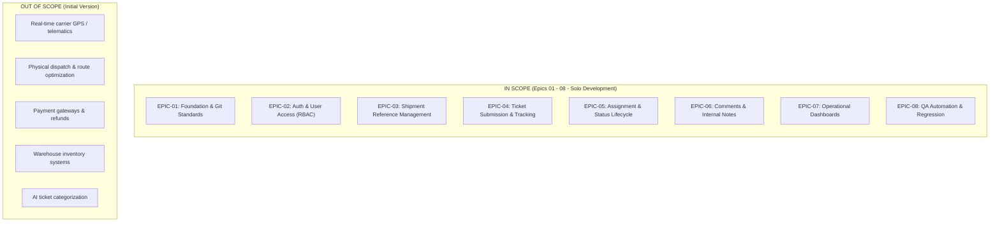
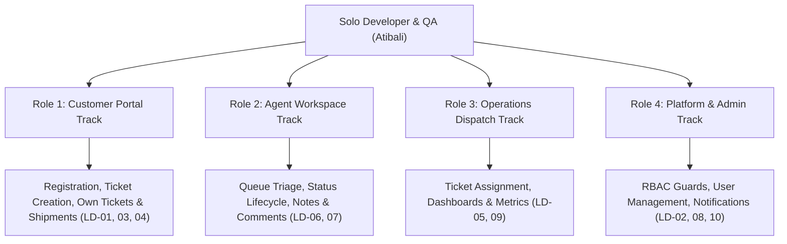

# LogiDesk – Master Test Strategy

**System Under Test**: LogiDesk – Logistics Operations HelpDesk Platform  
**Architecture**: ASP.NET Core Web API (.NET 11) + Angular SPA (v21 Standalone)  
**Execution Model**: Solo Engineer / Single Developer & QA (Atibali)  
**Version**: 1.1  
**Date**: November 2026  
**Target Audience**: Developer/QA (Solo Owner), Trainer, Reviewer  

---

## 1. Mission & Solo Quality Objectives

As a **single engineer** responsible for developing, maintaining, and validating the LogiDesk system, quality assurance cannot rely on large-team ceremonies or manual handoffs. The test strategy must be **lean, highly automated, reproducible, and fast**, ensuring one developer can confidently maintain high standards across all four application roles:
- **Customer**
- **Support Agent**
- **Operations Manager**
- **Administrator**

### Key Solo Quality Targets
* **Maximum Automation ROI**: Heavy reliance on unit and automated API integration tests (fast execution, zero flakiness) complemented by targeted Playwright smoke tests for multi-role workflows.
* **Deterministic Single-Developer Workflow**: One-command test execution (`dotnet test` for backend, `npx playwright test` for E2E) with automated database resets so testing does not require manual cleanup.
* **Zero Cross-Role Leaks**: Comprehensive verification of Role-Based Access Control (RBAC) and customer data isolation (no IDOR/BOLA) across all four roles.
* **Continuous Self-Validation**: Every pull request and local build automatically runs regression suites prior to landing code on `main`.

---

## 2. Scope of Testing



---

## 3. Solo Role & Functional Domain Coverage Matrix

Rather than spreading across multiple teams, **one engineer owns all four role domains**. The table below establishes the test coverage checklist across all roles:



### Role Test Coverage & Verification Checklist

| Role Domain | Backlog Stories | What the Solo Engineer Must Verify | Test Method |
|---|---|---|---|
| **1. Customer Portal** | `LD-01`, `LD-03`, `LD-04`, `LD-T03` | • Registration validation, password hashing, email uniqueness<br>• Shipment ownership checks (customer cannot attach another's shipment)<br>• Customer ticket creation boundary tests<br>• Strict ticket data isolation (Customer only sees own tickets) | Unit Tests + API Integration + Playwright Form Smoke |
| **2. Support Agent Workspace** | `LD-06`, `LD-07` | • Allowed vs rejected status transitions (State Machine)<br>• Resolution notes mandatory capture<br>• Internal notes data leak: Customer API query never returns `isInternal: true`<br>• Chronological comment sequencing | Backend API Integration + State Machine Parameter Tests |
| **3. Operations & Dispatch** | `LD-05`, `LD-09` | • Manager assignment & reassignment permissions<br>• Active agent selection filtering (deactivated agents excluded)<br>• Dashboard summary counts strictly match DB records | Backend xUnit Tests + Manager UI Verification |
| **4. Platform & Administration** | `LD-02`, `LD-08`, `LD-10`, `LD-T01/02/04` | • JWT generation, claims validation & expiry<br>• Unauthorized (401) vs Forbidden (403) status codes on all endpoints<br>• Admin user management: role updates, active/deactivate toggle<br>• Self-lockout prevention (admin cannot deactivate themselves)<br>• Notification event triggers | Automated RBAC Matrix Tests + Admin UI Smoke |

---

## 4. Solo Test Pyramid & Quality Levels

For a solo developer, heavy end-to-end UI tests carry high maintenance overhead. Therefore, the strategy emphasizes **fast, deterministic unit and API tests**, reserving UI tests for critical end-to-end golden paths:

```text
        ▲
       / \        E2E UI Smoke Tests (Playwright) - 10%
      /   \       • 1 multi-role end-to-end journey covering Customer -> Manager -> Agent
     /-----\
    /       \     Integration & API Tests (xUnit / WebApplicationFactory) - 35%
   /         \    • Full RBAC matrix, status transitions, data isolation, negative tests
  /-----------\
 /             \  Unit Tests (xUnit & Angular) - 55%
/_______________\• Domain models, password hashing, validations, auth signals, route guards
```

### 4.1 Unit Testing
* **Backend (.NET)**: xUnit testing domain models, `AuthService`, `UserService`, `PasswordHasher`, and EF Core in-memory database. (Currently 13 tests passing in $< 2$ seconds).
* **Frontend (Angular)**: Reactive form validators (`passwordMatchValidator`), signal states, and route guards.

### 4.2 Integration & API Testing
* **Automated RBAC Matrix**: A single parameterized test suite verifying that each endpoint (`/api/auth/*`, `/api/tickets/*`, `/api/admin/*`) behaves correctly for all 4 roles and unauthenticated callers.
* **State Machine Validation**: Parameterized test iterating over all status transitions (`OPEN` $\rightarrow$ `ASSIGNED` $\rightarrow$ `IN_PROGRESS` $\rightarrow$ `RESOLVED` $\rightarrow$ `CLOSED`).

### 4.3 End-to-End (E2E) UI Testing
* Single automated Playwright test suite validating the complete cross-role story:
  1. Customer registers and submits a ticket linked to a shipment.
  2. Manager logs in and assigns the ticket to an active Agent.
  3. Agent logs in, shifts status to `IN_PROGRESS`, and posts an internal note and public comment.
  4. Customer logs in, confirms the public comment is visible and internal note is absent.
  5. Agent marks the ticket `RESOLVED`.

---

## 5. Test Data Strategy for Solo Developer

To keep local development frictionless without requiring manual test data cleanup:

1. **Deterministic Pre-Seeded Accounts (Active in DB Initializer)**:
   * **Admin**: `admin@logidesk.com` / `Admin@123`
   * **Manager**: `manager@logidesk.com` / `Manager@123`
   * **Agent**: `agent@logidesk.com` / `Agent@123`
   * **Customer**: `customer@logidesk.com` / `Customer@123`
2. **Ephemeral Test Entities**: Automated tests append timestamps (e.g. `user_<ticks>@example.com`) to guarantee isolation.
3. **Zero-Friction DB Reset**: SQLite database file (`logidesk.db`) can be wiped and re-created in seconds via `DbInitializer`.

---

## 6. Solo Engineer Defect Management & Priority

Since one developer manages triage and fixes:

| Priority | Criteria | Solo Action Plan |
|---|---|---|
| **P1 - Blocker** | Security leak (cross-customer ticket visibility, plaintext password, crash) | Stop all feature work; patch and verify immediately. |
| **P2 - Critical** | Core workflow broken (cannot create ticket, cannot assign, cannot update status) | Fix before proceeding to the next backlog story. |
| **P3 - Medium** | Edge case validation failure, incorrect non-critical message | Log in backlog and fix during story refinement. |
| **P4 - Low** | Minor styling flaw or cosmetic alignment | Address during polish phases. |

---

## 7. Solo Definition of Done (DoD)

A story is marked **Done** by the solo engineer only when:
- [ ] Code meets all stated Acceptance Criteria.
- [ ] Unit tests pass locally (`dotnet test`).
- [ ] API integration tests verify positive, negative, and unauthorized paths.
- [ ] Automated regression suite passes with zero failures.
- [ ] Backlog status in `LogiDesk_Initial_Product_Backlog.xlsx` updated to `Done`.
